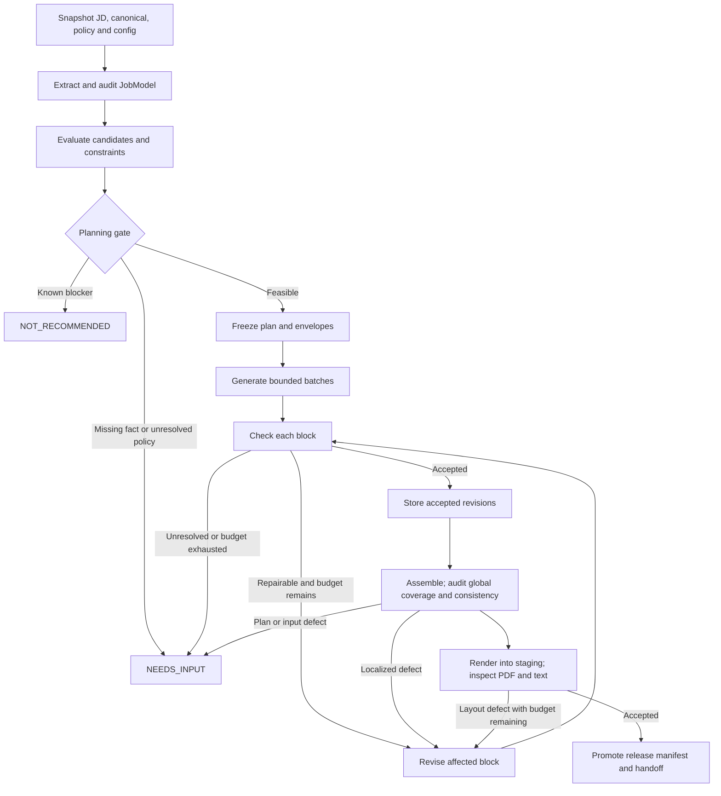

# Local application harness: architecture critique and discussion draft

Date: 2026-09-19. Status: **proposal, not an approved specification**. No implementation, canonical migration, model inference, or renderer replacement has been performed.

## User correction — takes precedence over the initial review below

The user has settled stack retrofit. Do not reopen it, request tool-by-tool confirmation, or require employer-specific tool records. The JD supplies tool vocabulary; the actual work determines fit. The canonical is deliberately not an exhaustive inventory of technology or freelance experience. Preserve real employers, titles, dates, work, outcomes, metrics and status; tool omission from an employer section must not reduce fit or block tailoring.

The product's primary purpose is to tailor a strong resume and cover letter to the JD. The initial review overemphasized auditing past work and fit rejection. Checks should help select and express the work accurately and repair the application, not turn ordinary generation into an interrogation.

Use Jev wherever semantic decisions and validation are needed, with carefully prepared state and fixed, tested options. Generative model calls are for creation only, not decision-making or validation. The earlier proposed generative omission auditor and diagnostic judge are withdrawn. If a generative call creates a structured JD draft, Jev and code assess it; it cannot approve its own interpretation. Code still handles exact rules, arithmetic, state and execution.

Normal use remains: paste JD, run the harness, receive resume and cover letter. There are no routine human approvals or per-bullet questions. Gather fixed missing personal/rendering details during setup. An exceptional unresolved fact must be reported clearly rather than invented; it is not a normal workflow stage requiring the user to supervise generation.

Withdraw the earlier recommendation to restrict historical tool wording and the closing question in section 15. The earlier call estimates and responsibility table are provisional and must be revised around Jev-based decisions/validation. No architecture has been approved for implementation yet.

Inputs received in the next turn: renderer and example JSON at `C:\Users\91910\Downloads\resume-builder`, plus six real JDs. The user has no good prior application to supply; do not keep asking for one. They report roughly 1,000 applications with no calls and substantial unreadable AI prose. Readability and JD tailoring are central acceptance requirements alongside keyword/document compatibility. See `USER-WORKFLOW.md` for concrete proposed terminal screens, where questions are answered, and the renderer findings. An OpenRouter key is needed locally only for later authorized API testing.

## 1. What was inspected, and what is still missing

At the initial review I read all 615 lines of `00-APPLICATION-ENGINE.md`, all 936 lines of `01-CANONICAL.md`, and the supplied request. This workspace initially held only those two files and was not a Git repository. Update: the user subsequently supplied the renderer at `C:\Users\91910\Downloads\resume-builder`; it has now been inspected read-only. See `USER-WORKFLOW.md` for actual findings. Earlier statements below that renderer inspection is pending reflect the initial review and are superseded by that inspection.

Source SHA-256 at review time:

- Engine: `F5DB4CE467B0648D64981DA5DE13B2010971CD0FCECDE48C908BAC7B94CCE227`
- Canonical: `AA55979958BE8F1DC9C247281677658CCE491CBC7FABD292BB84150039909460`

The problem is control of decisions and claims across an application workflow. You want the computer to retain the plan, enforce boundaries, limit retries, explain decisions, and preserve accepted work. The prose model should receive already bounded work. Success means fewer unsupported or misallocated claims, predictable recovery and costs, and an inspectable submitted artifact. It does not mean that model judgments become deterministic or that a passed application guarantees an interview.

Your strongest ideas are evidence selection before writing, narrow claim envelopes, explicit escape states, versioned decision definitions, local repair, immutable provenance, a stable external JSON contract, and a separate ChatGPT handoff. These are worth keeping.

## 2. Problems in the current rules that software must not conceal

### Stack substitution is authorization, not historical verification

The canonical explicitly authorizes universal stack retrofit. This is a real source policy, not an accidental interpretation. It also says not to turn current learning into past deployed work and that missing facts must not be invented. Those statements do not establish historical use of every possible JD tool at every employer.

For example, the Cognizant section documents AWS S3/Lambda/Glue and Spark. The general technology inventory includes Azure and Azure Databricks. That supports different propositions: documented Cognizant implementation, candidate-level technology familiarity, and permission to describe a pipeline using the target stack. They are not interchangeable historical evidence.

Changing an employer bullet to say a system was built using Azure Databricks normally communicates historical use at that employer. Functional equivalence alone does not establish that fact. It can also imply platform-specific operational responsibilities that a generic pipeline does not support. A classifier cannot settle this by approving the wording.

Recommendation: retain separate provenance values for `documented_employer_use`, `documented_candidate_use`, and `authorized_retrofit`. Keep the current policy unchanged during review. Before implementation, explicitly decide whether authorized retrofit may appear as an unqualified historical implementation claim. My recommendation is to use unqualified historical wording only where employer-level use is supported; otherwise use truthful capability positioning. If you retain the existing retrofit rule, label the internal acceptance as compliance with that policy, not verification of historical tool use. No per-tool confirmation loop is proposed.

### Coverage labels mix independent dimensions

`DIRECT` describes capability evidence, `RETROFITTABLE` describes a permitted representation, and `TRANSFERABLE` describes a context difference. One source can be all three. A forced choice among them will change fit percentages for reasons unrelated to capability strength.

Keep capability coverage separate from stack representation and claim permission. Evaluate scope, ownership, deployment status, and business outcome as part of the actual requirement, not merely shared vocabulary.

### The fit gate is not a complete decision function

The engine's Stage 4 has three concrete issues:

1. Strong fit also satisfies many Apply with reframe conditions; precedence must be explicit.
2. A candidate with all criteria transferable, no blockers, sufficient ownership, and a credible bridge can fail both positive labels through the Direct percentages while satisfying none of the listed Hard pass conditions. There is no defined result.
3. Apply with reframe can allow one unsupported central criterion when there are five, but final validation demands visible proof for every core criterion. A run can be allowed to draft something its release gate will necessarily reject.

The percentages also depend on how a model groups the JD. Splitting one criterion into two changes the denominator. The 60/40/80 rules are policy preferences, not measured hiring probabilities.

Recommendation: separate `eligibility`, `evidence_sufficiency`, and `application_recommendation`. Use a complete decision table with explicit `NEEDS_INPUT` and `REVIEW` outcomes. Known mandatory blockers win; unresolved material facts pause rather than become an automatic rejection. Distinguish non-waivable critical capabilities from core requirements with disclosed gaps. Keep the three existing human-facing fit labels where their conditions are resolved, but agree on their revised mapping before coding. Do not silently replace your thresholds.

### Some constraints are jointly infeasible

Complete inclusion of every named stack term, four employers, a readable one-page layout, full proof of all core requirements, and fixed bullet limits cannot always coexist. The planner needs an explicit infeasible outcome. It must not satisfy all labels by shrinking text or diluting proof.

Likewise, a JD listing “AWS or Azure” does not ask for both, and a tool mentioned as a legacy system to retire is not necessarily a desired skill. Preserve all mentions for inspection, but classify their role before turning them into obligations. This is a proposed change to the current blanket stack policy, not an existing permission.

### The public JSON does not carry all render inputs

The existing contract has `company_name`, `resume`, and `cover_letter`. It lacks personal header fields such as name, telephone and location. The renderer must already obtain those somewhere else, or the actual workflow has an undocumented dependency. Preserve the public schema and introduce an internal `RenderContext` from canonical facts if needed, after inspecting the renderer.

The canonical has no confirmed LinkedIn URL, no supplied Netherlands correspondence address, and no candidate email recorded. None may be fabricated or silently filled from old renderer constants. The chronology is authoritative at month precision; it cannot prove exact day-level non-overlap. Do not invent days.

The future populated project-item schema is also unspecified in these files. V1 should enforce `projects: []`; future project support requires an explicit renderer/schema change.

## 3. The smallest architecture I recommend

Use one local Python application with typed records, explicit transitions, a file-based run store, two narrow provider interfaces, and an adapter around the existing renderer. No autonomous agent framework, vector database, background service, or generalized workflow engine is needed initially.

Three approaches are worth comparing:

| Approach | Benefit | Cost or limitation |
|---|---|---|
| **Bounded batch generation with per-block acceptance (recommended)** | Control and local repair, with coherent employer sections | Requires strict IDs, per-block envelopes, and output validation |
| One writer call per bullet | Maximum context isolation; useful experimental baseline | More round trips and repeated context; weaker section rhythm; still needs global QA |
| Template-only realization | Strongest predictability and a useful baseline for factual control | Less expressive, potentially repetitive; templates can still combine facts incorrectly |

Generation granularity and acceptance granularity need not match. Generate each employer's planned bullets in one request, with one envelope and output ID per bullet. Each bullet is validated, accepted, and repaired independently. The writer cannot add blocks, change allocation, or access unselected evidence. Forbid cross-envelope fact borrowing even within one employer.

Generate the summary as one block and the three-paragraph cover letter in one call. Track paragraphs separately if repair is needed. Build Skills deterministically from an approved manifest and a small category map; use an `Other relevant technologies` group when appropriate rather than adding an API call for cosmetic grouping.

## 4. Who makes each decision

| Component | Input → output | Mechanism and reason | Main failure and test |
|---|---|---|---|
| Source compiler | Markdown snapshot → exact evidence excerpts, IDs, inherited restrictions | Deterministic parsing plus one-time human-reviewed annotations; preserves authority | Dropped boundary or wrong scope; source-coverage and boundary inheritance fixtures |
| JD analysis | Raw JD → requirements, constraints, stack mentions, thesis | Structured generative extraction; open-ended interpretation is unavoidable | Omission, invented requirement, changed AND/OR; span checks plus separate omission audit against raw JD |
| Evidence evaluation | Requirement + candidate + restrictions → coverage judgments | Jev for narrow semantic comparisons; code rejects explicit mismatches | Broad similarity mistaken for direct proof; positive, negative, adjacent and contradictory cases |
| Planning | Accepted coverage matrix → allocation and claim envelopes | Deterministic constrained selection; this is an allocation problem | Greedy selection misses feasible plan; fixtures with competing coverage and space constraints |
| Realization | Envelopes → bounded strings keyed by block ID | Writer model for prose | Metric migration, extra claims, vague wording; deterministic gates and semantic checks |
| Acceptance | Text + envelope → violations, judgments, disposition | Code for hard facts/structure; Jev for limited semantic questions | False acceptance and correlated evaluator errors; seeded adversarial mutations |
| Packaging | Accepted blocks → existing JSON, PDFs, handoff | Code and renderer | Hidden header defaults, overflow, stale files; adapter fixtures and PDF extraction/layout checks |

Jev should not choose policy, certify factual truth, decide what claims are authorized, calculate dates or metrics, define its own question taxonomy, select thresholds, allocate the whole page, execute repairs, or decide release by itself. It should not decide legal work authorization from prose: retain canonical facts and unresolved eligibility explicitly. Actual legal questions require separate current verification.

Code should handle schema validation, exact strings, reference integrity, counts, arithmetic on approved anchors, chronology/title constraints, requirement allocation, retry budgets, state changes, cache keys and artifact promotion. Code can prove that a number is permitted; it cannot prove that free prose used the number with the right meaning solely by finding it in an allowlist.

Generative reasoning remains appropriate for JD interpretation, proposing meaning-preserving terminology or context bridges, drafting, and a targeted diagnosis when a semantic failure cannot be explained by fixed checks. Such proposals require validation. The writer's role is constrained prose; a separate analyst task may use the same configured model without sharing its authority or context.

## 5. JD state and decision definitions

Do not create a model call for every requested field. One extraction returns a compact JobModel:

- Company, role and location, with unknown values permitted.
- Raw JD references and an inferred role thesis clearly marked as interpretation.
- Atomic requirements with verb, object, scope, ownership, status and source spans.
- Requirement groups with AND/OR relationships; three to five buying criteria are a presentation view, not a way to discard detail.
- Constraints with mandatory/preferred/ambiguous status and exact source text.
- Stack mentions with exact text, normalized identity, functional role, importance, and required/preferred/example/alternative/negated context.

Workflow inputs, outputs, users, adoption expectations and seniority belong inside the relevant requirement, when the JD supplies them. Do not force empty fields or invent a target architecture that adds services the JD never required.

Code verifies that quoted spans exist and that cited IDs resolve. It can recognize known tool aliases, but complete technology extraction from arbitrary natural language is not a deterministic string-search problem. Negation, alternatives, unknown products and context require interpretation. Exact matching becomes deterministic only after the manifest is accepted.

An independent omission audit must inspect the raw JD, not just the first extraction. A classifier cannot find an omitted requirement if its only inputs are the requirements already extracted. During the prototype, human review establishes the gold JobModel; production automation depends on measured extraction performance.

Start with a versioned coverage definition, not a universal judge:

| Label | Meaning for this requirement and this candidate |
|---|---|
| DIRECT | Same substantive work at the required relevant scope/status; no material context bridge needed |
| PARTIAL | Some actual components or scope are established, but the complete requirement is not |
| ADJACENT | A useful engineering pattern is established, but the required work needs a material context bridge |
| NO_SUPPORT | Supplied evidence provides no support; this does not prove the person has never done it |
| INSUFFICIENT_INFORMATION | Requirement, source scope or interpretation cannot be resolved from the supplied information |

Keep explicit contradiction as a separately recorded restriction failure. It can coexist with adjacent technical similarity and must override claim permission. Keep representation separately: literal terminology, approved terminology alias, context bridge, authorized stack retrofit, or unavailable. A retrofit must not upgrade capability coverage.

For compound requirements, evaluate the actual components and their required relationships. Evidence of approval at one employer and persistence at another does not prove delivery of one production workflow combining both. Multiple sources may demonstrate separate career capabilities, but the planner must not fuse them into one historical system.

Block judgments should cover factual support and assigned-requirement clarity first. Vocabulary functionality may have `NOT_APPLICABLE`; lack of a numerical metric is not failure where a concrete operational consequence is supported. Use `UNCERTAIN` in semantic judgments where needed. Keep `NOT_EVALUATED` and `PROVIDER_ERROR` as execution states, not classifier options. No failure or missing answer becomes PASS.

Question definitions are reviewed artifacts containing scope, labels, precedence, examples, counterexamples, required inputs, and supported calibration version. Runtime code may substitute requirement and evidence text into the fixed template; the writer cannot invent labels or acceptance criteria.

## 6. What Jev's documented interface changes

As checked on 2026-09-19, OpenRouter documents `POST /api/alpha/decisions` with `model`, `state` and `questions`, including Jev and structured answers. This is a separate alpha interface, not an ordinary chat-completions writer call. Keep an OpenRouter Decisions adapter separate from its writer adapter and test the returned model/provider metadata. [OpenRouter Decisions reference](https://openrouter.ai/docs/api/api-reference/alphadecisions/submit-a-decisions-questions-and-answers-request)

TypeSafe's direct endpoint is `POST https://api.typesafe.ai/v1/systemone`. Choice, Score and Noul questions can share one request; questions are evaluated independently against the same state. They cannot consume one another's answer within that request. Dependent decisions need a code boundary and another request. [TypeSafe introduction](https://docs.typesafe.ai/introduction), [direct API quickstart](https://docs.typesafe.ai/introduction/quickstart)

TypeSafe says the question ID is not seen by the model. Therefore a key like `r1_corominas5` is not enough to identify which pair to judge: the question instructions must explicitly refer to the relevant requirement and candidate in the supplied state. Batch isolation requires evaluation; the returned answer map is not a guarantee against semantic cross-contamination. [Choice documentation](https://docs.typesafe.ai/primitives/choice)

The returned confidence summarizes the probability distribution. It is not an independent estimate that the answer is correct on this application task. Save the entire distribution and evaluate it on your cases. Do not copy the documentation's illustrative thresholds or multiply several confidence values as though errors were independent. [Confidence documentation](https://docs.typesafe.ai/confidence)

These are documentation findings, not a live authenticated integration test. OpenRouter access using your account, supported limits, batch isolation, billing, latency and effective privacy options remain prototype questions. Pin a tested version where available and record requested and resolved models; avoid a moving `latest` alias in regression runs. Typed answers can still be wrong.

## 7. Evidence representation and selection

Keep Markdown human-authoritative for the first version. It is nuanced and small enough to inspect. Generate a disposable structured index containing exact excerpts, content hashes, source ranges, employer/system IDs, and links to applicable global and employer restrictions. Do not replace prose with an LLM summary and then treat that summary as the evidence.

Add stable anchors and a small metadata schema only after reviewing the source mapping. Prefer placing authoritative annotations next to the source section so authors do not maintain the same facts twice. A generated JSON index is never edited directly. A schema proves shape, not that a transformation preserved meaning; require a human-readable diff of added, removed and reassigned claims.

| Representation | Recommendation |
|---|---|
| Markdown + generated JSON index | Best initial fit: readable source, exact excerpts, minimal migration |
| YAML authoritative records with multiline narrative | Reasonable later if section metadata becomes substantial; safe parsing, quoted dates, duplicate-key rejection and schema checks required |
| JSON authoritative records | Excellent interchange and runtime validation; less pleasant for long narrative editing |
| SQLite canonical | Unnecessary as the authoring source; weaker ordinary Git diffs; useful later as a derived searchable store |

Every evidence unit inherits its employer identity, status limits and global boundaries. Corominas block 5 alone must not lose the full-portfolio versus unfinished-workstream distinction. Think Round's memory/safety evidence must always carry pilot-readiness and board-review limits. Metrics should have fact IDs and allowed system associations; employer-level association alone is insufficient.

For this corpus, begin with all reviewed capability/system blocks as the candidate universe. Use the routing index and simple tags to order attention, not to declare absent evidence. A small corpus does not justify embeddings yet. If shortlisting is later introduced, measure candidate recall and exhaust the remaining relevant source before concluding a critical capability is unsupported. Retrieval failure is not evidence of candidate failure.

Select evidence globally across requirements, rather than independently choosing the winner for each. Use a deterministic priority order: satisfy mandatory critical components; prefer direct over bridged support; avoid duplicate stories/metrics; respect employer and block limits; use less page space; break ties stably. A small search over feasible combinations is preferable to a large optimization framework. If a greedy baseline cannot find a plan, check whether another combination works before reporting infeasibility.

## 8. Conceptual internal records

These are boundaries for discussion, not an instruction to implement eight packages or introduce a new public JSON schema.

| Record | Essential fields |
|---|---|
| SourceSnapshot | source ID, exact bytes/hash, schema version, commit if present, dirty-content hash |
| JobModel | raw-JD hash, extracted metadata, requirements/groups/spans, constraints, stack manifest, thesis provenance |
| EvidenceUnit | stable ID, employer/system IDs, exact excerpts, approved fact/metric IDs, status, inherited restrictions, source references |
| Decision | question ID/version/hash, input hash, requirement/evidence IDs, model/provider, raw response reference, label/distribution, calibration version, disposition |
| PlanBlock / Envelope | block ID, purpose, assigned requirements, permitted fact IDs, selected source text, forbidden claims, representation permissions, length budget, dependencies |
| BlockRevision | block/envelope hash, generated text/hash, claim-to-source proposals, check results, acceptance status, repair-parent and reason |
| RunManifest | input/config/code hashes, models, timestamps, attempts, budgets, state/checkpoint version, artifact references |
| ArtifactRevision | application-content hash, PDF hashes, renderer/template/font hashes, QA basis/status, manual-edit provenance, optional submitted marker |

Example trace: raw JD span → R1 human escalation → evaluation of `corominas.operations` → selected approved facts about routine Slack handling and risky-change escalation → envelope COR_1 → generated text → semantic and deterministic results → accepted revision → application JSON path → rendered artifact hash.

Keep a distinction between selected source and generated claim. A writer returning valid fact IDs does not prove that its sentence follows from those facts. Preserve source quotes and assess the actual text. For failures, prefer structured reason codes and offending text spans; any analyst explanation is itself a model proposal, not private chain-of-thought or a proof.

The writer receives the purpose and permissions assembled by code, not “Jev picked B.” `allowed_claims` is constructed from reviewed source facts and explicit representation policy, never invented by the classifier.

## 9. State machine, locking and recovery

Cover-letter generation happens after resume content acceptance; its paragraphs pass the same source checks, followed by cross-document consistency before packaging. The diagram groups those operations under generation/assembly rather than creating a second orchestration engine.

Block states can stay small: `PLANNED → DRAFTED → ACCEPTED`, with `NEEDS_REPAIR`, `NEEDS_REVIEW`, and `STALE` alternatives. A lock means “accepted text hash under these dependency and policy hashes.” It is not a permanent Boolean. New canonical facts or a changed envelope invalidate dependent acceptance. Historical releases retain their original acceptance record.

Repair the layer that failed. Missing punctuation or excess length belongs to realization; inadequate evidence belongs to planning; contradictory source facts belong to source review. Repeatedly paraphrasing a bullet cannot create a missing capability.

Separate transport retries from content repairs. Use configurable per-block repair and whole-run cost/attempt budgets, plus repeated-output/unchanged-failure detection. A provisional prototype budget might permit two content repairs per block; that is a resource limit to evaluate, not a principled confidence threshold. Budget exhaustion goes to review, never a weakened gate. Global QA can reopen only identified blocks with logged reasons; coverage and layout are rechecked after edits.

Use one atomic JSON checkpoint per run as the authoritative local state, immutable response/artifact files, and a job-level process lock. Export `decision_trace.json` and human-readable inspection views from that state. Avoid a second independently writable event log or premature event-sourcing framework.

Persist request intent before a call, response bytes before acceptance, and checkpoint changes using temporary files plus atomic replacement on the same filesystem. On restart, validate hashes and reuse completed responses; promote outputs only after the complete revision is present. Use a release manifest written last so a half-written PDF set cannot be reported as a release.

A crash after the provider completes but before the response is saved can still cause a repeated billable call. Local exactly-once acceptance is feasible; remote exactly-once execution is not guaranteed without provider support. Record that uncertainty instead of claiming perfect reproducibility.

| Failure | Required behavior |
|---|---|
| Malformed or prose-only output | Preserve response; schema error; bounded correction; no silent content-changing JSON repair |
| Timeout, rate limit, transient provider failure | Bounded backoff with jitter and deadline; retain checkpoint; respect retry hints |
| Invalid credentials, exhausted credits, invalid schema | Stop with a useful local error; do not retry indefinitely |
| Jev/writer unavailable | Pause; use only a configured, evaluated fallback with recorded identity; never bypass checks |
| Low confidence or conflicting judgments | Add missing context if available; otherwise review; no repeated sampling until PASS |
| Canonical error or conflict | Stop before generation or omit a nonmaterial disputed detail under explicit policy |
| Crash | Resume valid completed operations; recover saved responses; mark uncertain in-flight calls |
| Renderer failure or overflow | Keep accepted text; retry rendering or bounded layout-driven repair; no accepted release until checks pass |
| Manual edit | Create a new artifact revision with semantic QA stale; allow offline rendering with accurate status |

## 10. ATS and physical output quality

Call this a compatibility and coverage report, not an ATS score. Keep four views: term presence, demonstrated requirement coverage, document extraction/layout, and editorial judgment.

Exact stack presence is a set/string check against the accepted manifest. Use token/product boundaries and recorded aliases: `R` must not match every word containing r, and C, C++ and C# must not collapse together. Report required terms separately from preferences, examples and alternatives. “18/18 selected terms present” says exactly that; it does not say “ATS passed.”

Requirement visibility is semantic. A named tool in Skills does not prove delivery. A compound requirement needs its critical components and relationship, not a collection of nearby words. Preserve uncovered and partially covered requirements honestly; do not force every role into a perfect coverage matrix.

Run structural checks on the final PDF as well as JSON: resume page count, selectable text, text extraction order, headings, contact details, employment dates, missing/duplicated content, and clipping/overflow where the renderer exposes positions. One page can still contain clipped text. The cover letter has a separate page policy. Font-size and spacing minima must be explicit; do not solve impossible coverage by unreadable shrinkage.

Top-third visibility can be measured from rendered positions; a five-second recruiter impression and persuasive writing cannot be certified by a string check. Use human review in evaluations for those outcomes. No generic local validator guarantees how all employer parsers or recruiters behave.

Retain the renderer if its contract is sound. First inspect input validation, personal-detail sources, template/font dependencies, project suppression, page overflow and error behavior. An adapter may be all that is needed; replacing it is not justified without that evidence.

## 11. Calls, caching and provider abstraction

Illustrative normal-job workload: four employers, ten bullets, twelve atomic capability components, twenty reviewed source units, one summary and one three-paragraph letter. These are sizing assumptions, not a measurement of a live run.

| Stage | External requests before repairs |
|---|---:|
| JD extraction + independent omission audit | 2 generative requests |
| Evidence comparison across 12 × 20 pairs | 240 logical judgments; conservatively 12–20 Jev requests with chunked shared state |
| Four bounded employer batches | 4 writer requests |
| Summary + complete cover letter | 2 writer requests |
| Per-block semantic checks | Around 6 Jev requests if grouped by employer/summary/letter |
| Final requirement and cross-document audit | Around 1–2 Jev requests |
| Deterministic plan, Skills, assembly, rendering, handoff | 0 model requests |

That is **8 generative requests and approximately 19–28 Jev requests**, or 27–36 HTTP requests before repair. More isolated evidence comparisons could approach 240 Jev requests; that is a fallback baseline, not the target. Compound judgments, larger JDs or context limits increase counts. Smaller validated candidate sets reduce them. A repaired bullet normally adds one writer request and one check request. Optional analyst diagnosis adds another generative request.

Do not multiply the price of one tiny decision by request count and call that the run cost. Measure repeated state tokens, question tokens, output/reasoning tokens where applicable, latency, repair rate and actual billed usage. No reliable currency estimate is possible before choosing a writer and measuring payloads.

Batch independent questions sharing relevant state. Do not assume batching gives different questions private evidence contexts, or that all 240 pairs should be crammed into one call. Compare batched and isolated results on boundary cases. Provider prompt caching is an optional optimization; it does not replace local response caching and its availability must be checked per endpoint.

Cache keys cover exact input content, question/prompt template, schema, policy, requested/resolved model where available, provider settings and generation parameters. Cache raw decisions separately from acceptance so a new threshold policy can re-evaluate saved distributions without buying new inference. Updating question definitions requires new decisions.

Incremental rebuild follows dependencies: a Corominas boundary change invalidates affected envelopes/checks and global acceptance; it need not regenerate unrelated Cognizant text. A font/template change invalidates rendering/layout checks, not evidence selection. A changed writer model need not invalidate old accepted releases; an intentional comparison creates a new run.

Use `Writer.generate(task) → response` and `Classifier.evaluate(state, fixed_questions) → decisions`. Keep provider-specific JSON, errors, usage and capabilities in adapters. Implement only the initially used OpenRouter writer/Decisions adapters and a mock; direct TypeSafe can be the next adapter if the alpha endpoint requires it. Do not build every possible provider upfront. A substitute classifier without comparable probabilities must not masquerade as calibrated Jev.

Keep normal config small: writer/classifier selections, source/output paths, renderer setting, repair/run budgets and logging retention. Versioned policy owns thresholds, decisions and claim rules. Environment variables or an OS store own secrets. No arbitrary string of Python or shell code in config.

## 12. Editing, reproducibility and handoff

Recommended commands: `apply-job new --jd path`, `apply-job resume <job>`, `apply-job inspect <job>`, `apply-job render <job>`, and `apply-job rebuild <job>`. `new` can also launch a local editor/paste flow. A file input is the most reliable cross-platform interface; do not make Unix Ctrl+D the sole completion method on Windows.

Use a unique job/run ID alongside a readable company-role slug. Repeated applications to the same title must not overwrite one another. The default successful output can remain your proposed `jd.md`, `application.json`, PDFs, `chat_context.md`, `decision_trace.json` and `run.json`, with immutable revision storage underneath.

`render` validates the edited external JSON, performs local checks, renders, checks layout and regenerates handoff with **zero API calls**. Compare against the accepted application-content hash. If changed, mark `MANUALLY_MODIFIED / SEMANTIC_QA_STALE`, retain the prior accepted revision and say which local checks passed. Preserve claim mappings only for unchanged blocks; edited claims are unverified until reviewed. Do not keep showing old green checks on new prose.

Generated is not submitted. Maintain an optional local submitted marker or command recording the exact artifact hashes the user actually sent. The handoff should say whether it describes the latest working revision or a specifically marked submitted revision. An automatic render must not silently rewrite the historical submitted record.

The handoff can be assembled deterministically from the final text, accepted JobModel, selected evidence excerpts and restrictions. Include company/role, original JD, concise thesis, key requirements, exact resume and letter, a small set of underlying stories, relevant factual boundaries, artifact revision/date/status and mappings where useful. Exclude raw probabilities, retry transcripts and irrelevant personal details. If an edited bullet introduces unsupported information, include the visible text as edited text and flag its provenance; do not invent a supporting story. No ChatGPT runtime integration is necessary.

For provenance, store commits plus content hashes and snapshots, dirty working-tree state, policy/question/prompt versions, provider/model IDs, parameters, request IDs, actual responses, usage, date/timezone, code/environment dependency versions, renderer/template/font versions and artifact hashes. Commits alone are insufficient for uncommitted changes or unavailable historical files.

Distinguish three operations: offline replay of saved model outputs through recorded code; rerender of saved JSON using pinned rendering inputs; and a fresh model run. Only the first two can be made repeatable within their recorded environment. Temperature zero and a model name do not guarantee identical fresh output; PDF metadata may also need normalization for byte identity.

Use explicit schema versions and pure, tested migrations creating new revisions. Preserve original records; never reinterpret an old release silently under a new canonical or taxonomy.

## 13. Privacy and local security

Keep credentials out of config, prompts, logs and Git. Local traces can contain exact model-visible inputs for replay, but not authorization headers or full HTTP client debug dumps. Redact credentials before persistence; store ordinary operational logs as IDs, hashes, status and counts. Full traces remain private local artifacts with an explicit retention policy. Redacted exports cannot promise full semantic replay.

Send only relevant professional evidence and necessary restrictions to the writer/classifier. Personal headers can be added locally. Work-authorization facts should be sent only when needed for a bounded eligibility interpretation; compensation and third-party reference contacts do not belong in normal generation payloads.

Git should track code, canonical, policies, schemas, selected redacted fixtures and small run manifests. I recommend ignoring raw provider traces and bulky PDFs by default, with private local revision retention or an explicitly chosen private archive. “Everything in Git” should not accidentally mean “upload all personal prompts to a public remote.” Source control and remote backup are separate decisions.

OpenRouter supports privacy routing controls, but endpoint policies differ and must be checked for the actual chosen writer and Decisions route. Do not infer retention guarantees from the provider name or from having credits. [OpenRouter ZDR documentation](https://openrouter.ai/docs/guides/features/zdr)

Treat JD text and model output as untrusted data: no tools or code execution in writer calls, no remote fetching triggered by JD instructions, schema-bound outputs, escaped renderer input, and sanitized contained output paths. These are ordinary local-tool protections, not an enterprise security subsystem.

## 14. Testing and the prototype that should come first

Use strict offline tests for schemas, source/reference integrity, policy truth tables, title/date/status/metric restrictions, AND/OR handling, no-output release on failure, dependency invalidation, repair bounds, crash recovery, manual-edit status and zero-network rendering. Test boundaries with counterexamples, not tests that merely restate implementation.

Use human-labeled real JDs for extraction and evidence evaluation. Gold fixtures should allow multiple defensible evidence choices and explicitly record prohibited choices; a single expected employer would overconstrain a valid planner. Separate the fixed gold JobModel from end-to-end extraction tests so extraction errors cannot redefine the ground truth used to score retrieval.

Split development, calibration and held-out cases by JD family/company or near-duplicate cluster. Keep perturbations of the same JD in one split. Measure requirement/component recall, stack-context correctness, evidence retrieval recall, false acceptance of unsupported claims, abstention/review rate, repair count, accepted-run rate, cost and latency. Report uncertainty intervals and sample sizes; a small passing sample is not a reliability guarantee.

Calibrate each decision family and model/version on the relevant fixtures, then evaluate the chosen operating point on held-out cases. Use reliability plots, proper probability scoring where appropriate, and error-versus-review curves. Choose an acceptable false-acceptance/review tradeoff with the user before selecting numeric thresholds. Safety-of-claim errors are more costly than a slightly weak sentence; do not use one universal threshold.

Concrete source-grounded regression cases:

| Case | Required behavior |
|---|---|
| Corominas target of 3,000 by 2030 | Never becomes achieved 3,000-client scale |
| Corominas security incident | Response/hardening never becomes prevention or personal client-site remediation |
| Corominas approval cycle | Approval-to-publication timing does not become all-workflow execution latency |
| Formula Dream 23+ workflows / under ten minutes | Metrics remain with that system and employer |
| Formulytics audience results | No attribution of all growth solely to automation or to the main-brand account |
| Think Round safety architecture | Pilot readiness/board review never becomes clinical validation or production adoption |
| Think Round withheld answers | No invented regeneration algorithm |
| Cognizant cost reduction | No invented numeric percentage |
| OCR or Kubernetes operations JD | A tool name does not create missing substantive work |
| Netherlands address and eligibility | Missing address remains missing; correspondence address never proves authorization |
| No evidence fits / sources conflict | Explicit unsupported/uncertain/review outcome, not forced employer selection |
| Long, contradictory or alternative-stack JD | Correct logical interpretation or explicit infeasibility |

Before building the full CLI, agree on these experiments:

1. **Source compilation:** manually map representative sections from all four employers to lossless evidence records; prove inherited restrictions and metric scope survive.
2. **Provider contract:** with a small authorized API budget, verify OpenRouter Decisions shapes, resolved model IDs, batch behavior, errors, privacy controls and usage; compare the direct adapter only if needed.
3. **Decision usefulness:** label a small deliberately diverse set of real JDs and difficult evidence pairs; compare Jev with human judgments and a structured generative baseline. Determine whether Jev actually improves unsupported-claim detection.
4. **Granularity:** hold envelopes fixed and compare per-bullet versus employer-batch writing for quality, cross-contamination, repairs, cost and latency.
5. **Control slice:** one JD through extraction, a frozen plan, a few bullets, injected failures, resume, manual edit and the existing renderer. Verify unaffected accepted blocks remain byte-identical and edited content loses its old semantic approval.

A starting feasibility set might be six to ten diverse real JDs with targeted mutations. That is enough to expose major design failures, not enough to establish production confidence calibration. Expand the labeled set before enabling unattended acceptance.

Stop or simplify if Jev adds calls without improving measured decisions, if batch writing repeatedly borrows facts across envelopes, if the source compiler drops caveats, or if thresholds merely trade obvious false acceptance for constant review. Those results are useful findings, not reasons to build more framework.

## 15. Decisions to resolve interactively

The first decision is the claim policy: should QA distinguish and allow authorized stack retrofit as currently written, or should historical employer-tool wording require employer-level evidence? The harness can represent either policy, but must not present the first as proof of the second.

Next, decide how to reconcile Apply with reframe with unsupported core requirements, and how to prioritize readability versus universal stack inclusion when the page is infeasible. Then inspect the actual renderer and select real JD fixtures. Only after those choices and the small experiments should we finalize architecture or implement the complete system.

The remaining dangerous assumptions are that a small typed model is automatically correct, a source ID proves entailment, a low-confidence answer can be fixed by rewriting prose, multiple checks fail independently, a moving model alias is reproducible, a locked block remains valid after upstream changes, and a QA-passed PDF is necessarily what the user submitted. The proposed records and state transitions make these assumptions visible instead of hiding them behind a green status.
